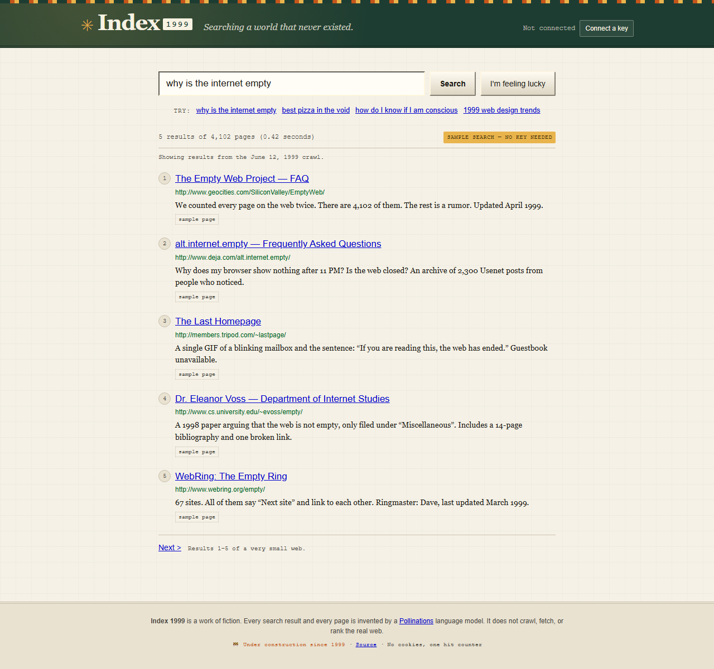
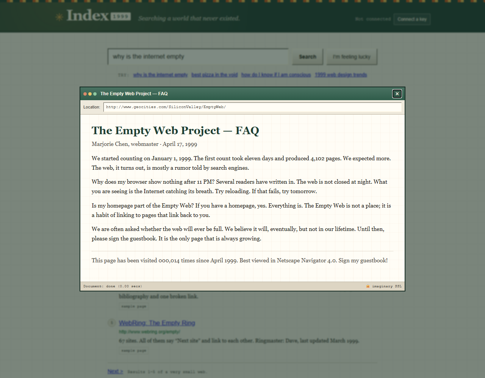

# Index 1999

**A search engine for a world that never existed.**

Index 1999 looks like a web search engine from 1999. It is not one. It is a
language model pretending to be one: every result, URL, guestbook, and
under-construction GIF is invented on the spot.

- Ask for anything and get five period-correct search results.
- Click a result and the model writes the page behind it.
- Bring your own Pollinations key, so every search spends your own Pollen.
- Or press **try the sample search** and explore the Empty Web with no key at
  all.

**Live:** https://kreggscode.github.io/index-1999/



Clicking a result opens the page the model wrote for it:



## Why

Most search engines promise to find the real web. Index 1999 does the opposite:
it searches a small, fictional 1999 web of 4,102 pages, complete with Geocities
homepages, Usenet FAQs, university departments, and a WebRing where every site
links to every other site. It is a tool for writing, a toy for browsing, and a
game about how much of the web is already a model's idea of the web.

The app is a response to the **“An app or game where a model plays a machine”**
quest: here the machine is a search engine, and the model plays the whole
index — crawler, ranking, snippets, and the pages themselves.

## How it works

- The search page sends one `POST https://gen.pollinations.ai/v1/chat/completions`
  call to the `openai` text alias with `response_format: { "type": "json_object" }`.
- The model returns five results in the shape
  `{ corrected, notice, results: [{ title, url, snippet }] }`.
- Clicking a result sends a second call that returns the page body
  `{ title, author, last_updated, body[], footer }`.
- The UI, the crawler progress bar, the hit counter, and the 1999 styling are
  local. Only the text is generated.
- There is no backend, no database, and no real crawl. The app is static
  HTML/CSS/JS and can be hosted on GitHub Pages.

The key is stored in `localStorage` and sent only to
`gen.pollinations.ai`. Get one at
[enter.pollinations.ai/keys](https://enter.pollinations.ai/keys).

### The no-key sample

The **sample search** is a bundled, pre-written result set for
“why is the internet empty”. It lets reviewers use the app without a key and
without spending Pollen. Every model-generated result is marked as an
“invented page”; the sample pages are marked as “sample page”.

## Run locally

```bash
npx serve .
# or: python -m http.server 8080
```

Then open <http://localhost:8080>. No build step.

## Files

- `index.html` — the page, search form, results, and fake browser dialog.
- `styles.css` — the 1999 look, responsive layout, and browser chrome.
- `app.js` — key handling, model calls, JSON validation, rendering, sample data.
- `screenshot.png` — the screenshot used in the app submission.

## Honesty

Index 1999 never fetches a real URL. Every search result and every page is
fiction generated by a model. The footer says so, the app marks generated
results, and the sample is clearly separated. The page is a demonstration of
the Pollinations text API, not a web search product.

## License

MIT
